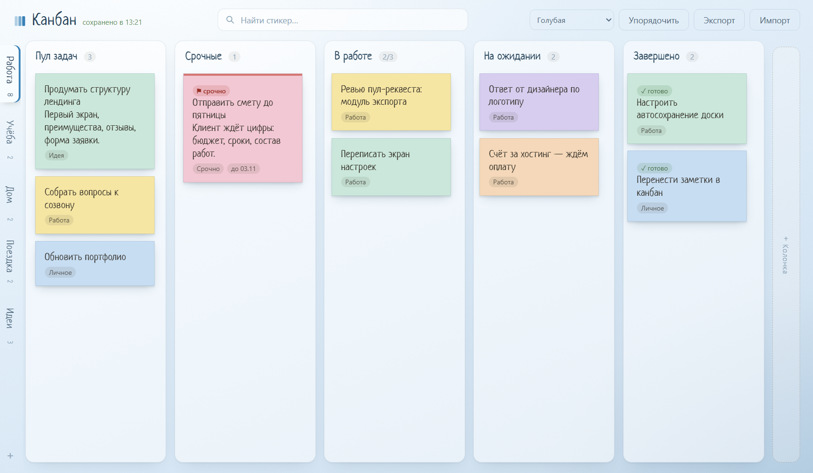

# Канбан — настольная доска со стикерами



Лёгкое настольное приложение для личных задач: рабочий лист, разлинованный на вертикальные поля, а задачи — свободно перемещаемые стикеры. Всё живёт локально на компьютере, никакого облака и регистраций.

## Что это

Метод канбан пришёл с заводов Toyota («канбан» — «видимая карточка»), а в 2010-х Дэвид Андерсон адаптировал его для интеллектуальной работы. Суть метода в том, что поток работы **виден целиком**, а незавершённой работы (work in progress) **ограничено количество**. На практике это доска с колонками-этапами и карточками-стикерами, которые движутся слева направо, пока не доедут до «Завершено».

Это приложение — именно такая доска, только рабочая, без командных надстроек и подписок.

## Возможности

- **Пять колонок по умолчанию** — «Пул задач», «Срочные», «В работе», «На ожидании», «Завершено». Колонки добавляются («＋ Колонка» на доске), переименовываются (клик по заголовку) и удаляются.
- **Свободная доска.** Стикер живёт там, где его бросили, и может стоять на границе колонок. Перетаскивание живое: движется сам стикер, без призрака. Колонка при этом считается по центру стикера.
- **Магнит и расталкивание.** Стикер прилипает к центру дорожки, краям соседей и сетке; наехавший на соседа мягко сдвигает его вниз с живым предпросмотром. Если стикер вырос при дописывании текста, нижние стикеры автоматически съезжают, чтобы не оказаться под ним.
- **Создание в один клик.** Клик по пустому месту — сразу печатаешь (как в OneNote), клик мимо сохраняет. Черновик уже в цвете будущего стикера.
- **Правка на месте.** Клик по стикеру — инлайн-правка текста без модалки; полное окно (метка, цвет, срок) — по карандашу ✎ или Enter. У текста единый блок с рич-форматированием: жирный, курсив, списки, размер шрифта (всплывающий тулбар с копированием выделенного). Ctrl+Z/Ctrl+Shift+Z/Ctrl+Y работают внутри правки предсказуемо — своя история не конфликтует с undo браузера. Enter — новая строка, сохранение — Ctrl+Enter или клик мимо.
- **Мультивыделение.** Рамка-протяжка, Shift+клик, групповой перенос всей пачки с учётом WIP, удаление пачкой (Delete или кнопка «Удалить») с отменой «Вернуть».
- **Шесть тем доски** — «Крафт», «Рисовая бумага», «Голубая», «Пробковая доска» (стикеры на булавках), тёмный «Графит», «Меловая доска». Переключатель в верхней панели, тема хранится вместе с доской.
- **Несколько досок.** Вкладки-закладки слева: создание, переименование, удаление, переключение и перетаскивание для изменения порядка. Если подержать стикер над вкладкой другой доски, доска откроется прямо во время перетаскивания — стикер можно поставить в нужную колонку и место, не отпуская мышь.
- **Прокрутка вкладок без колеса.** Когда досок много, в панели вкладок появляются кнопки ▲/▼ (их можно удерживать), а с клавиатуры работают ↑/↓ и PageUp/PageDown. При перетаскивании стикера к верхнему или нижнему краю вкладок панель прокручивается сама, чтобы добраться до нужной доски.
- **Упорядочить.** Кнопка в верхней панели раскладывает все стикеры ровными стопками по центру своих колонок — удобно после серии переносов.
- **Прокрутка средней кнопкой.** Зажми колесо мыши и веди доску в любую сторону — как в графических редакторах.
- **WIP-лимиты.** У колонки можно задать предел числа задач (⚙ в заголовке). Пока лимит выбран, новые стикеры не добавляются и не переносятся — счётчик краснеет и показывает `3/3`. Это и есть pull-система: сначала завершаем, потом берём следующее.
- **Поиск по доске** (Ctrl+F) — фильтрует стикеры на лету, данные не трогает.
- **Автосохранение.** Любое изменение немедленно уезжает в файл в каталоге данных приложения. Подпись в углу показывает время последнего сохранения.
- **Удаление обратимо.** Удалённый стикер уходит в мягкий архив, тост предлагает «Вернуть». Архив старше 30 дней вычищается при запуске. Удаление колонки стикеры не трогает — они остаются на месте и переназначаются соседним колонкам.
- **Горячие клавиши.** Ctrl+N — новая задача в пуле, Ctrl+F — поиск, Ctrl+Enter — сохранить текст, Ctrl+Z — отменить правку текста, Esc — закрыть/снять выделение, Delete — удалить выбранные.

## Установка и запуск

### Готовые сборки

Скачай из раздела [Releases](https://github.com/Neuro-Storm/kanban/releases):

- **Linux** — `kanban-1.4.0-x86_64.AppImage`: `chmod +x` и запустить.
- **Windows** — `kanban-setup-1.4.0.exe`: обычный установщик (NSIS).
- **macOS** — собирается из исходников командой `npm run dist:mac` (нужен macOS).

### Из исходников

Нужен Node.js 20+ и npm.

```bash
npm install       # поставит Electron (скачается бинарник)
npm start         # запуск в режиме разработки
```

### Сборка дистрибутива

```bash
npm run dist      # Linux AppImage  → dist/kanban-*.AppImage
npm run dist:win  # Windows-установщик (NSIS), требует wine на Linux-сборщике
npm run dist:mac  # macOS dmg (собирается только на macOS)
```

## Разработка

```bash
npm test          # юнит-тесты ядра доски (node --test), 63 проверки
npm run smoke     # смоук-тест в настоящем Electron (140 проверок: доски, drag, магнит, рамка, темы, рефлоу, новые механики)
npm run shot      # снять кадры artifacts/preview.png и preview-editor.png
```

### Структура

```
electron/           главный процесс
  main.js           окно, хранилище (атомарная запись JSON), смоук-режим
  preload.js        мост contextBridge — только доска, без файловых API
src/core/store.js   ядро: состояние, правила, порядок, WIP-лимиты, автосохранение
src/ui/             интерфейс: рендер, перетаскивание, редактор, тосты
tests/unit.test.cjs юнит-тесты ядра
scripts/            smoke.sh, shot.sh, make-icon.sh
assets/fonts/       Neucha и Caveat (SIL OFL)
build/              иконка приложения
```

### Как устроено (коротко)

- **Ядро отделено от UI.** `store.js` не знает ни о DOM, ни об Electron: его гоняют юнит-тесты в чистом Node. Это позволяет проверять правила (лимиты, порядок, санитизацию) без запуска графики.
- **Порядок задаётся дробными числами.** Вставка между соседями берёт середину между их `order`; если соседи стали слишком близки, доска нормализуется шагами по 1000. Гонка сходимости проверена тестом на 40 вставок в одну щель.
- **Атомарная запись.** Файл доски пишется через временный файл и переименование — обрыв не оставит половинчатый JSON. При загрузке данные санитизируются: битые задачи отбрасываются, чужие колонки чинятся, старые удалённые вычищаются. Нечитаемый файл не роняет приложение: рядом остаётся копия `*.corrupt-*`, поднимается стартовая доска.
- **Перетаскивание своё.** Никаких drag-n-drop библиотек: pointer-события, движется сам стикер (без призрака), подсветка дорожки, магнит к центру/краям/сетке, живое расталкивание соседей. Стикер можно перетащить на вкладку другой доски — он уедет в её пул. Без зависимостей — значит, без сюрпризов в поведении.
- **Привязка к колонкам при ресайзе и масштабе.** Стикер хранит абсолютный `x`, а дорожки — flex. У каждой доски сохраняется геометрия дорожек (`board.layout`), поэтому при открытии в другом размере окна или после смены масштаба стикеры пересчитываются относительно СВОИХ колонок — в том числе на досках, которые не были открыты в момент ресайза. Удаление колонки не теряет стикеры — они остаются на месте, владелец переназначается по центру.
- **Асинхронная запись.** Сохранение идёт через очередь в главном процессе без фриза интерфейса; при выгрузке — блокирующий `flushSync`. Очередь переживает ошибку диска, ревизии не дают старой записи перезаписать новую, а рядом с файлом ротируются бэкапы `kanban-board.json.bak` и `.bak.1`. Есть экспорт/импорт через диалог файла.
- **Темы — токены.** Оформление задаётся CSS-переменными под `html[data-theme]`; выбор хранится в файле пространства (`theme`), старые файлы молча получают «Крафт».
- **История текста своя.** В contenteditable-редакторах (стикер, черновик, полное окно) Ctrl+Z/Ctrl+Shift+Z/Ctrl+Y обслуживает собственный снимок состояний, поэтому форматирование и вставка не ломают отмену.

### Палитра и оформление

Фон — тёплый «письменный стол» с бумажной фактурой, дорожки — полупрозрачные листы, стикеры — шесть пастельных цветов без наклонов (наклоны мылили текст). Шрифты: Neucha (заголовки и текст на стикерах) и Caveat (акценты) — оба под лицензией SIL OFL 1.1, лежат в `assets/fonts/`. Тёмные темы («Графит», «Меловая доска», «Пробка») перекрашивают и стикеры, редактор при этом остаётся светлым листом.

Приложение уважает системную настройку `prefers-reduced-motion` — анимации отключаются.

## Где лежат данные

`kanban-board.json` в каталоге данных приложения:

- **Windows**: `%APPDATA%/Канбан/kanban-board.json`
- **macOS**: `~/Library/Application Support/Канбан/kanban-board.json`
- **Linux**: `~/.config/Канбан/kanban-board.json`

Файл — обычный JSON, его можно скопировать или отредактировать при выключенном приложении. Рядом приложение держит `kanban-board.json.bak` и `.bak.1`; если файл не удалось прочитать, его копия сохраняется как `kanban-board.json.corrupt-*`.

## Почему в диспетчере несколько процессов Electron

Это нормальная архитектура Chromium/Electron, а не утечка или ошибка в коде: отдельных процессов требует изоляция вкладок и рендерера. В простое на Windows наблюдаются 4 процесса:

1. **main** — окно, IPC, файлы, диалоги;
2. **renderer** — сама доска (`app.js`, DOM);
3. **GPU** — отрисовка и анимации;
4. **utility** — сетевой/служебный процесс Chromium.

Само приложение не создаёт ни `Worker`, ни `child_process`, ни дополнительных `BrowserWindow` — в коде таких вызовов нет. Отключать GPU (`--disable-gpu`) не стоит: это ухудшает плавность анимаций и перетаскивания.

## Лицензия

MIT. Шрифты — SIL OFL 1.1 (см. `assets/fonts/OFL.txt`).